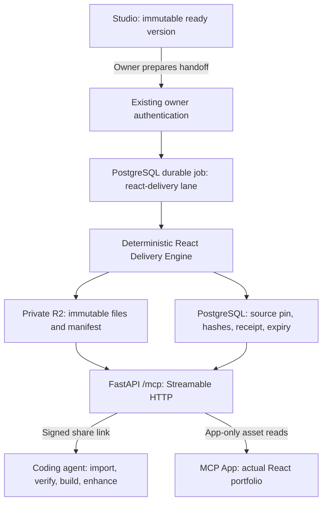

# React Delivery Engine and MCP sharing

React delivery is implemented behind `[react_delivery].enabled = false`. It follows an explicit **Prepare React handoff** action in Studio. It does not call a model, change the generated portfolio, or add a supervisor. A live release and feature activation remain separate operator actions.



## Project and verification contracts

`react-delivery/src/themes` contains native React implementations of the currently selectable pinned themes. CSS, local fonts, illustrations and licenses come from the sealed theme package. React owns navigation, dialogs, menu state, reveal markup, counters and motion effects; the original `theme.js` is never exported or executed. `scripts/compile_react_themes.py` is a development migration aid, not a runtime converter. Review generated components and retain hand-maintained interactions when rerunning it.

Each project includes TypeScript/React source, Vite configuration, an exact dependency manifest and lockfile, public `portfolio.json`, assets, README, delivery receipt and file manifest. Installation needs the recipient's package registry or cache. After import, the project needs neither an OryxenAI account nor a live MCP connection.

Public content is projected through `PortfolioPageContent`; briefs, evidence, prompts, session metadata, credentials and chat history are excluded. Only supported sealed theme revisions pass. Unsupported revisions and deterministic schema/size failures stop without model repair.

Theme verification runs in CI: type checking, browser interactions, mobile/desktop fixture rendering, hero visual comparison with the original renderer, reduced motion and keyboard checks. The acceptance importer transfers each supported project through the actual MCP transport, then installs, type checks and builds it. Browser coverage is an explicit matrix, not proof of every possible content or animation frame.

Staging visual review must also sign off lower-page layouts and decorative motion. The native adapters preserve the core interactions; the automated hero comparison does not establish identical pointer effects, transition choreography or film-style scrubber decoration.

Individual preparation checks source eligibility, theme compatibility, projected data, template hashes, required pinned assets, manifest and total size. Receipts say `not_run_for_this_portfolio` for browser verification. Template build checks do not imply that this particular portfolio was installed or browser tested on Render. Vite type checking runs separately.

## Persistence, concurrency and failures

`react_handoffs` records owner/session/source references, source and adapter fingerprints, viewer fingerprint, job, status, artifact prefix, manifest, receipt, failure and lifecycle timestamps. Its foreign keys use `SET NULL`, preserving artifact deletion information after account or session cascades. Apply migration `0029_react_handoffs` before enabling the feature.

The state path is `queued → preparing → validating → ready`; terminal states are `failed`, `revoked`, `expired`. Preparation uses the existing at-least-once PostgreSQL queue, authorization fence and lease token. It is explicitly portfolio-bound and consumes no model credit. The global delivery lane permits one job, below foreground generation priority. Each attempt has a separate immutable storage prefix. Promotion locks the portfolio, current job lease and handoff and rechecks eligibility before publishing all verified files together.

Repeat preparation of the same pending or live version returns its existing record without extending expiry. Another version cannot be prepared while one is pending. A replacement revokes the previous ready link only after successful promotion. A failing attempt preserves the earlier handoff. Only transient transport/storage failures receive the configured bounded worker retries; schema, theme and size failures do not.

Live source versions are excluded from both Studio pruning and retention pruning. Removing shared content marks its historical source restricted and revokes affected handoffs. Reads also check account, session, source, expiry and revocation on every request and again after storage I/O. Administrative archival/deletion therefore denies access immediately, independently of cleanup scheduling.

Cleanup runs at startup and periodically while the API is awake. It expires or revokes ineligible rows, closes orphaned preparations, retries interrupted prefix deletion and retains terminal metadata until the configured retention period after successful cleanup. A sleeping free service cannot delete on schedule; read-time expiry still enforces access. A separate two-day R2 lifecycle rule handles abandoned attempt files. This policy applies only to React handoffs, not Studio/session retention.

## API and MCP

The existing API base is `/api/v1`, so the owner routes are:

| Route | Behavior |
| --- | --- |
| `POST /api/v1/sessions/{id}/handoffs` | Prepare `{ "version_id": "<ready-version-uuid>" }`; returns status with HTTP 202. |
| `GET /api/v1/sessions/{id}/handoffs` | Recent pending, ready and terminal records for Studio refresh. |
| `GET /api/v1/sessions/{id}/handoffs/{handoff_id}` | Status, failure, receipt, expiry and signed link when ready. |
| `DELETE /api/v1/sessions/{id}/handoffs/{handoff_id}` | Revoke access. |

`/mcp` is remote Streamable HTTP with stateless requests. The official SDK supplies protocol handling and origin/host protection. Recipient access uses a signed share link, with no OryxenAI login or OAuth flow. Owner actions retain existing authentication and authorization.

| Tool | Contract |
| --- | --- |
| `get_react_project(share_link)` | Metadata, public manifest, instructions and verification receipt. |
| `read_react_project_file(share_link, path, cursor=0)` | Manifest-only base64 chunk with offsets, next cursor, chunk SHA-256 and complete file SHA-256. |
| `show_react_portfolio(share_link)` | React MCP App resource and its manifest; unsupported/unconfirmed hosts receive an explicit capability message. |
| `read_preview_asset(share_link, path, cursor=0)` | App-only visibility; only portfolio data and theme assets. Binary bytes stay outside model context. |

Failures include `NOT_READY`, `EXPIRED`, `REVOKED`, `FILE_NOT_FOUND`, `ARTIFACT_UNAVAILABLE` and retry guidance. Responses prevent caching; access logs redact share tokens. The share landing page only explains MCP connection and expiry. There is no code download button, ZIP endpoint, public bucket or separate source URL. An authorized recipient can retain imported code; revocation cannot erase their copy.

The MCP App is built from the same React components and contract as the project. It verifies asset hashes, uses local blob URLs and clears its view on expiry or failed access. The SDK bridge is covered with a local MCP Apps host harness. Actual ChatGPT account rendering is a separate acceptance check; merely returning the UI resource is not proof that a host displayed it.

## Configuration and deployment

1. Keep the feature disabled while validating the release in staging.
2. Build the product frontend and React templates before the backend tests. Docker's Node build stage prepares the viewer/templates; the Python runtime does not need Node or Chromium for handoffs.
3. Apply migrations using the configured application database. Integration tests use only `oryxenai_test`.
4. Set a dedicated random `HANDOFF_SIGNING_SECRET` of at least 32 bytes in `.env` or the host secret store. Keep it stable across API/worker restarts; rotation invalidates existing share links. Do not reuse an auth or preview signing key.
5. Configure `[react_delivery.storage]` with a private R2 bucket, S3 endpoint, region, prefix and credential environment names. Existing archival storage configuration is independent. Scope credentials to the required object reads/writes/deletion and lifecycle inspection.
6. Install an enabled lifecycle rule covering every object under `react-handoffs/`, with expiration after two days. Tag- or size-filtered rules do not cover all artifacts. Startup checks this policy; do not disable the check in production.
7. Configure the real HTTPS `auth.primary_origin` and allowed origins. API and worker must use the same settings, signing secret and React build.
8. Complete live R2, deployed cold-start, Codex plugin and ChatGPT rendering acceptance, then explicitly enable the flag and release the verified SHA.

Example bucket lifecycle rule (merge into the bucket's existing policy; do not replace unrelated rules):

```json
{"ID":"react-handoff-expiry","Status":"Enabled","Filter":{"Prefix":"react-handoffs/"},"Expiration":{"Days":2}}
```

Defaults are configured in `config/app.toml`: readiness-relative one-day access, 10 MiB total project/viewer limit, 32 KiB chunks, one preparation lane, 60-second attempts, at most three transient attempts, hourly cleanup and seven-day terminal metadata retention. S3 operations use bounded timeouts. Account-wide R2 allowances and Render bandwidth still apply; this feature is not unconditionally free.

Viewer compatibility is pinned to its built bytes. Startup rejects an incompatible build while pending or unexpired ready handoffs require the previous viewer, and a stale worker cannot prepare against a changed viewer. Keep compatible builds for live links. For an incompatible v1 change, drain preparation and let links expire before deploying; a future versioned viewer registry can remove that restriction. Do not disable sharing, rotate secrets, change bucket coordinates or replace lifecycle prefixes while live handoffs still need them. Imported source files remain immutable regardless of deployments.

An incompatible viewer protocol release must also version its MCP UI resource URI and adapter contract together, so client resource caches cannot reuse an earlier viewer for the new contract. The v1 release has one adapter contract and viewer resource.

## Local development and client import

From `react-delivery`, run `npm ci --ignore-scripts`, `npm run build:viewer`, and optionally `npm run dev`. The local development fixture uses fictional content and copies sealed theme assets into an ignored public directory. Exported project manifests do not include MCP SDK dependencies.

On Windows, `scripts/prepare-react-delivery.ps1` prepares the templates and checks the importer. The normal `scripts/test.ps1` and `scripts/check.ps1` launchers call it automatically. Other environments can use the equivalent npm commands below; CI prepares the same artifacts before running the Python suite.

From `plugins/oryxenai-react-handoff`, run `npm ci --ignore-scripts` and `node --test scripts/import-project.test.mjs`. The repository plugin connection targets local development. Make a separate plugin copy and replace `mcp.json`'s server URL with the verified HTTPS deployment `/mcp` endpoint before installing it in another client. Never distribute a localhost connection as a hosted integration.

The bundled `import-react-portfolio` skill invokes the programmatic importer. It creates a new directory, validates portable paths, transfers binary chunks directly to disk, verifies hashes and refuses to overwrite existing work. `--resume` is allowed only for the same handoff manifest and preserves edited files. Set `ORYXENAI_SHARE_LINK` in the process environment, then run:

```text
node scripts/import-project.mjs --endpoint <verified-mcp-url> --destination <new-project-directory> --build
```

The optional `--build` runs installation, type checking and production build. The skill then starts a preview using the host's available tools and reports results before enhancements. Hosts lacking execution or app rendering must report that limitation. The automatic tests use the official client and actual transport; installed Codex UI and other client products are not claimed compatible until separately tested.

Run the repository lint, formatting, typing, full test and migration checks. Also run the frontend build/tests and the importer checks. `tests/browser/test_react_delivery.py`, `tests/integration/test_react_handoffs.py` and `tests/integration/test_react_import_workflow.py` are the delivery acceptance entry points. Standard tests use fixtures and no live model calls.

Receipts record queue wait and preparation time. The importer reports transfer and installation/type-check/build durations. Measure cold-start and real storage timing separately in staging. Local fixture timings are not a latency promise. Public hosting, arbitrary application conversion, an exploratory model repair engine and automatic publication are outside v1.
